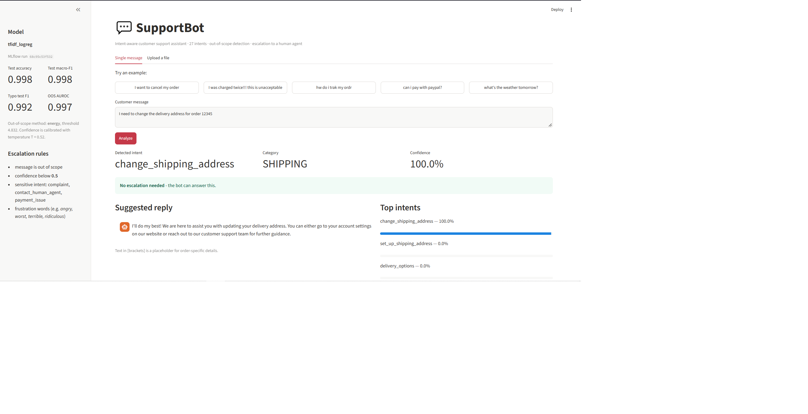
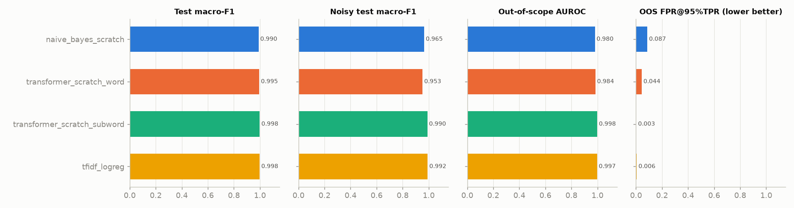
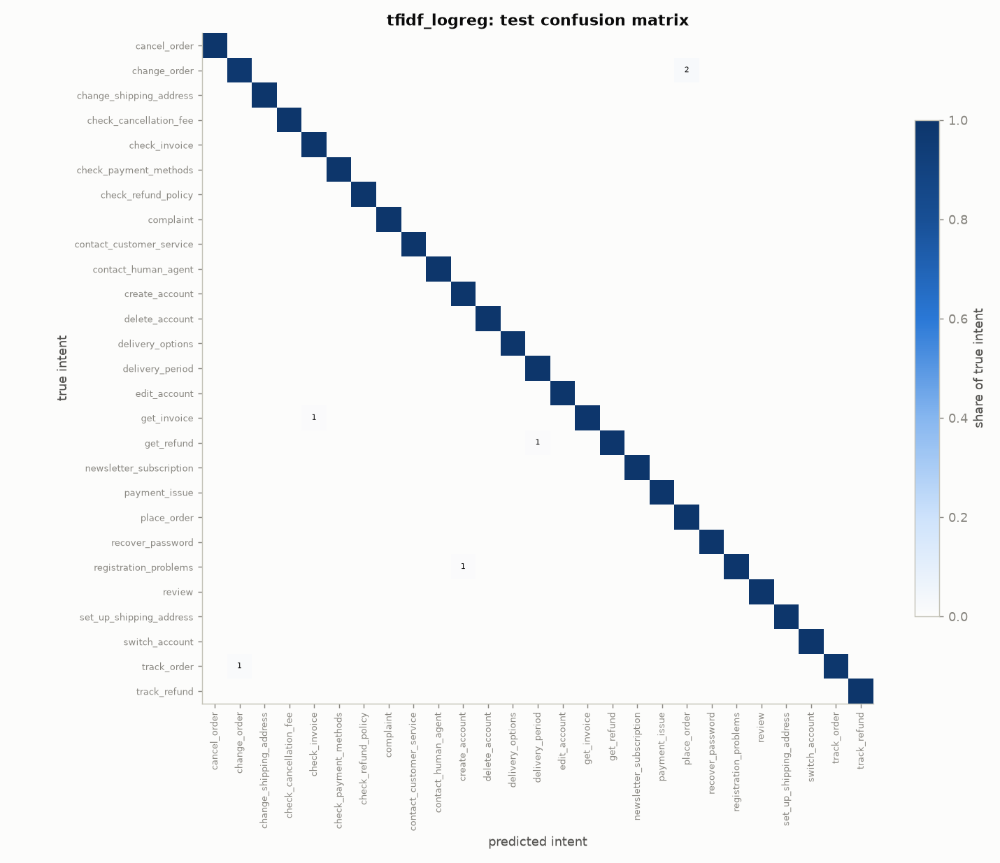
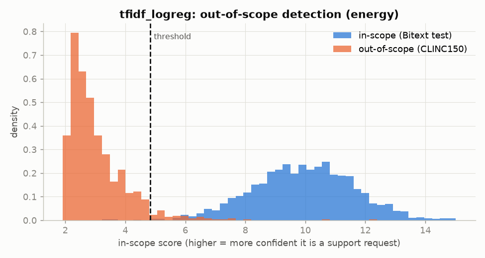
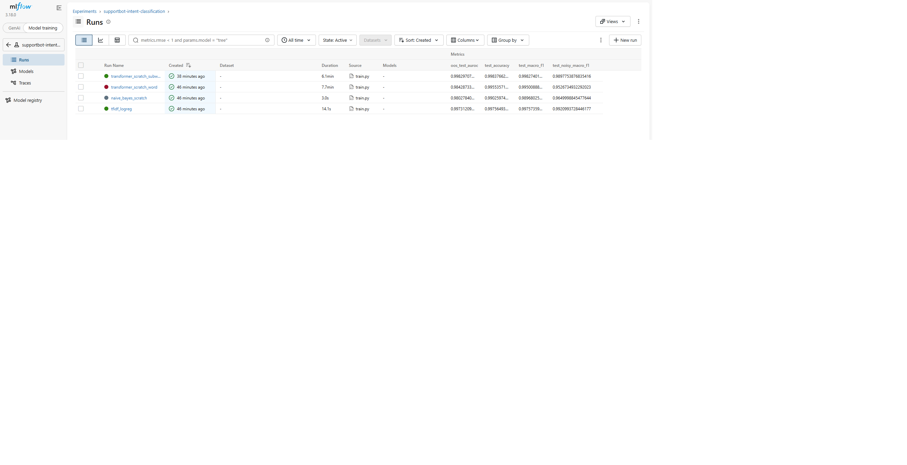
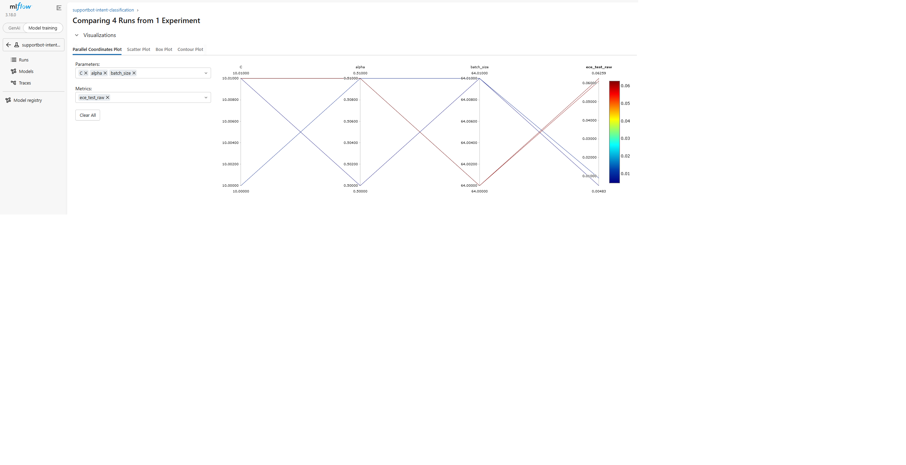
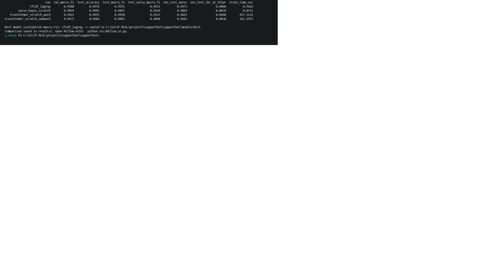
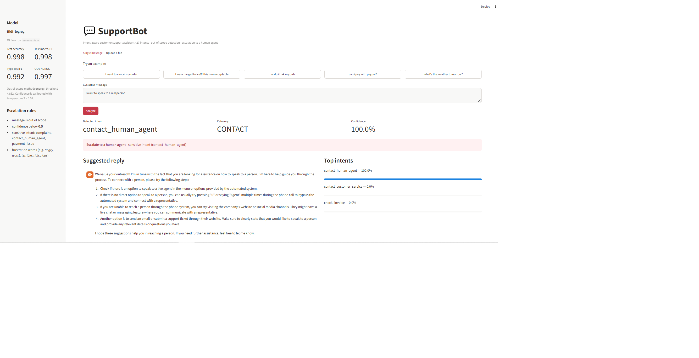
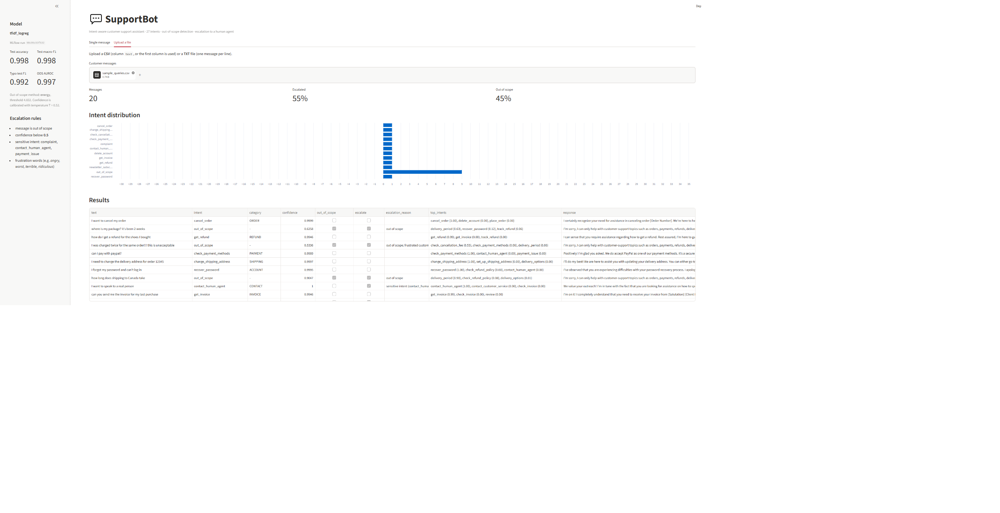

# SupportBot: An Intent-Aware Customer Support Chatbot with Dockerized Deployment and MLflow Tracking

**Domain:** NLP-powered chatbot for customer support. This is the SICIP (Skills for Industry Competitiveness and Innovation Program, BRAC University) ML/DL final project.

SupportBot reads a customer message and works out what the customer wants: one of **27 intents**, such as `cancel_order`, `get_refund` or `track_order`. It shows how **confident** it is and checks whether the message is a support request at all (**out-of-scope detection**). Then it recommends whether a **human agent** should take over and suggests a **reply**. You can type a single message or upload a CSV/TXT file of messages. The app runs in **Docker**.



---

## 1. Problem statement

Support teams receive thousands of short, informally written messages. To automate the first response, a system has to:

1. **route** each message to the right intent,
2. **know when it doesn't know**, rather than forcing an off-topic or unclear message into the closest intent,
3. **hand over** to a human when the customer is upset, the issue is sensitive or the model is unsure.

**Expected output for every message:** the intent and its category, a calibrated confidence, the top 3 intents, an out-of-scope flag, an escalation decision with its reason, and a suggested reply.

## 2. Dataset

| | Bitext customer-support dataset (training) | CLINC150 out-of-scope queries (evaluation only) |
|---|---|---|
| Source | [Hugging Face: bitext/Bitext-customer-support-llm-chatbot-training-dataset](https://huggingface.co/datasets/bitext/Bitext-customer-support-llm-chatbot-training-dataset) | [Hugging Face: clinc/clinc_oos](https://huggingface.co/datasets/clinc/clinc_oos) (`plus` config, label `oos`) |
| Size | 26,872 messages, 27 intents, 11 categories | 100 validation and 1,000 test queries |
| Columns used | `instruction` (message), `intent`, `category`, `response` | `text` |
| Licence | CDLA-Sharing-1.0 | CC BY 3.0 |

**Why it fits:** Bitext is written for customer-support intent detection. Its messages contain natural variation (colloquial phrasing, typos, politeness), and each one comes with a model reply. Bitext has no off-topic messages, so CLINC150's out-of-scope queries (e.g. *"what's the weather tomorrow"*) are used **only to test** whether the bot can recognise messages it shouldn't answer. They are never used for training.

**Preparation** (`src/data_download.py`):
- 2,237 duplicate messages are removed so the same text can't appear in both training and test.
- The data is then split with a **stratified 80/10/10 split** (seed 42): train **19,708**, validation **2,463**, test **2,464**.

```bash
python src/data_download.py      # downloads everything into data/  (not committed)
```

## 3. Methods

The trainer's feedback on the project proposal was to *improve/implement algorithms*. The core algorithms are therefore **written from scratch** and compared against a library baseline. There is one MLflow run per model.

| Model | Implementation | File |
|---|---|---|
| **TF-IDF + Logistic Regression** | scikit-learn baseline: word 1–2-grams and character 2–5-grams | `src/models/tfidf_logreg.py` |
| **Multinomial Naive Bayes** | **From scratch**: own n-gram vectorizer, Lidstone smoothing, log-space scoring | `src/models/naive_bayes_scratch.py` |
| **Transformer encoder (word)** | **From scratch** in PyTorch: own multi-head self-attention, pre-norm encoder blocks, positional embeddings, masked mean pooling, training loop | `src/models/transformer_scratch.py` |
| **Transformer encoder (sub-word)** | Same, plus **fastText-style hashed character 3–5-gram embeddings** for robustness to typos | `src/models/transformer_scratch.py` |
| DistilBERT fine-tuning *(optional, off by default)* | Transfer-learning comparison | `src/models/distilbert_finetune.py` |

**On top of the classifier** (`src/ood.py`, `src/predict.py`, `src/responder.py`):
- **Out-of-scope detection.** Three scoring methods are compared: maximum softmax probability (MSP), temperature-scaled MSP, and the **energy score**. The method with the best validation AUROC is used. The threshold is set on validation data.
- **Calibration.** **Temperature scaling** is fitted on validation data and measured with Expected Calibration Error (ECE).
- **Robustness test.** A copy of the test set has about 15% of words corrupted with typos.
- **Escalation.** A message goes to a human if it is out of scope, if confidence is below 0.5, if the intent is sensitive (`complaint`, `payment_issue`, `contact_human_agent`) or if it contains frustration words.
- **Reply.** The reply comes from the most similar training message (TF-IDF cosine similarity) **within the predicted intent**. Slots like `{{Order Number}}` are shown as `[Order Number]`.

### Important hyperparameters (`configs/config.yaml`)

| Model | Key settings |
|---|---|
| TF-IDF + LogReg | `C=10`, 30k word + 30k character features, sublinear TF |
| Naive Bayes | smoothing `alpha=0.5`, uni+bi-grams, `min_df=2` |
| Transformers | `d_model=128`, 4 heads, 2 layers, FFN 256, dropout 0.1, max 32 tokens, batch 64, AdamW (lr 1e-3, weight decay 0.01), one-cycle LR, label smoothing 0.1, gradient clipping 1.0, early stopping (patience 3, max 12 epochs), 20k character-n-gram hash buckets (sub-word run) |
| Out-of-scope | method `auto` (best validation AUROC); threshold keeps **99.5%** of in-scope validation messages (see 5.3) |

## 4. Course techniques used and where

| Technique | Where |
|---|---|
| Data collection, de-duplication, stratified splitting | `src/data_download.py` |
| Exploratory data analysis | `notebooks/exploration.ipynb` |
| Text preprocessing, tokenization, n-grams, TF-IDF | `src/common.py`, `src/models/naive_bayes_scratch.py`, `src/models/tfidf_logreg.py` |
| Probabilistic classifier (Naive Bayes), from scratch | `src/models/naive_bayes_scratch.py` |
| Linear classifier (Logistic Regression) | `src/models/tfidf_logreg.py` |
| **Transformers**: embeddings, multi-head self-attention, LayerNorm, residual connections, dropout | `src/models/transformer_scratch.py` |
| Optimisation: AdamW, LR scheduling, gradient clipping, label smoothing, weight decay, early stopping | `src/models/transformer_scratch.py` |
| Transfer learning (optional) | `src/models/distilbert_finetune.py` |
| Hyperparameter / threshold tuning on validation data | `configs/config.yaml`, `src/threshold_check.py` |
| Evaluation: accuracy, macro-F1, confusion matrix, per-class report, AUROC, FPR@95TPR, ECE | `src/train.py`, `src/evaluate.py`, `src/ood.py` |
| Calibration and out-of-distribution detection | `src/ood.py` |
| Robustness testing with noisy inputs | `src/data.py` |
| **MLflow** experiment tracking | `src/train.py`, `mlruns/` |
| Model selection on validation data | `src/train.py` |
| Inference pipeline + CLI | `src/predict.py`, `src/responder.py` |
| **UI serving** (Streamlit, text + file upload) | `app/app.py` |
| **Docker** | `Dockerfile`, `requirements-app.txt` |
| Reproducible project structure, config-driven runs, fixed seeds | whole repository |

## 5. Results

### 5.1 Model comparison (test set: 2,464 messages; out-of-scope test: 1,000 queries)

| Model | Val macro-F1 | Test accuracy | Test macro-F1 | Typo test macro-F1 | OOS AUROC | OOS FPR@95%TPR ↓ | Train time | Latency / msg |
|---|---|---|---|---|---|---|---|---|
| TF-IDF + LogReg | **0.9980** | 0.9976 | 0.9976 | **0.9921** | 0.9973 | 0.0060 | 9 s | 1.2 ms |
| Naive Bayes (scratch) | 0.9859 | 0.9903 | 0.9897 | 0.9650 | 0.9803 | 0.0870 | **0.9 s** | **0.3 ms** |
| Transformer, word (scratch) | 0.9921 | 0.9955 | 0.9950 | 0.9527 | 0.9843 | 0.0440 | 457 s | 3.0 ms |
| Transformer, sub-word (scratch) | 0.9975 | **0.9984** | **0.9983** | 0.9898 | **0.9983** | **0.0030** | 362 s | 2.5 ms |



**What the results show**
- **Every model is above 99% accuracy.** Bitext messages are paraphrases of each other, so in-distribution classification is easy. The more informative tests are typos and out-of-scope messages.
- **Sub-word embeddings fixed the from-scratch Transformer's weak spot.** On the typo test, macro-F1 rose from 0.953 to 0.990. Out-of-scope messages wrongly accepted (FPR@95%TPR) fell from 4.4% to 0.3%. The reason: a misspelled word like *"refnd"* still shares most character n-grams with *"refund"*.
- **TF-IDF was selected for the app.** It has the highest validation macro-F1, which is the only data the selection rule looks at. It is practically tied with the sub-word Transformer and trains about 40× faster.

### 5.2 Out-of-scope detection: AUROC by method (test)

| Model | MSP | Temperature-scaled MSP | Energy |
|---|---|---|---|
| TF-IDF + LogReg | 0.9976 | 0.9966 | 0.9973 |
| Naive Bayes (scratch) | 0.9777 | **0.9803** | 0.1051 |
| Transformer, word | 0.9831 | **0.9843** | 0.9758 |
| Transformer, sub-word | 0.9982 | 0.9979 | **0.9983** |

The **energy score fails for Naive Bayes** (AUROC 0.105, worse than chance). Naive Bayes outputs log-probabilities of the *whole message*, so the energy score becomes the message's likelihood, and short off-topic questions look *more* likely than longer support messages. The method is chosen automatically on validation data, so Naive Bayes uses temperature-scaled MSP instead.

### 5.3 Choosing the out-of-scope threshold

With the first threshold (accept 95% of in-scope validation messages), the bot rejected everyday phrasings that Bitext doesn't contain. Examples are *"can i pay with paypal?"* and *"how do I get a refund for the shoes I bought"*, even though the intent was predicted correctly with more than 99% confidence. `src/threshold_check.py` compares threshold rules for every model, using validation data plus the hand-written messages in `samples/sample_queries.csv`. Below is TF-IDF with the energy score:

| Rule (validation) | Validation in-scope accepted | Validation out-of-scope rejected | Real-style samples accepted (of 16) | Off-topic samples rejected (of 4) |
|---|---|---|---|---|
| keep 95% | 95.0% | 100% | 7 | 4 |
| keep 99% | 99.0% | 99% | 8 | 4 |
| **keep 99.5% (used)** | **99.5%** | **98%** | **11** | **4** |
| keep 99.9% | 99.9% | 89% | 12 | 3 |

Of the 5 sample messages that are still escalated, 4 would have been **misclassified** by every model: heavy typos (*"hw do i trak my ordr"*), *"charged twice!!!"* and *"where is my package?"*. Sending them to a human is the intended behaviour. The choice of threshold was guided by these 20 hand-written samples, so it is a judgement call and not an unbiased test result.

### 5.4 Final model: TF-IDF + Logistic Regression (`python src/evaluate.py`)

| Metric | Value |
|---|---|
| Test accuracy / macro-F1 | 0.9976 / 0.9976 |
| Typo test accuracy / macro-F1 | 0.9923 / 0.9921 |
| ECE before → after temperature scaling (T = 0.52) | 0.0089 → **0.0014** |
| Out-of-scope AUROC / FPR@95%TPR | 0.9973 / 0.0060 |
| Out-of-scope queries rejected at the chosen threshold | 95.6% |
| In-scope messages accepted | 99.76% |
| **End-to-end in-scope accuracy** (accepted *and* correctly classified) | **99.51%** |




## 6. MLflow tracking

Every training run logs:

- **Parameters:** model type, every hyperparameter, seed, dataset sizes and the chosen out-of-scope method.
- **Metrics:**
  - per-epoch training/validation loss, accuracy and F1 (Transformers);
  - validation, test and typo-test accuracy and macro-F1;
  - AUROC and FPR@95TPR for each out-of-scope method;
  - ECE before and after temperature scaling;
  - training time, latency per message, model size and number of parameters.
- **Artifacts:** confusion matrix, training curves, out-of-scope score histogram, classification report, misclassified test examples, `model_info.json` and the config used.

The best run is tagged `best_model = true`. The experiment contains 6 runs: the 4 models, plus 2 extra TF-IDF runs from the threshold experiments in 5.3.

```bash
python src/mlflow_ui.py          # opens http://localhost:5000
# or by hand (PowerShell):
# $env:MLFLOW_ALLOW_FILE_STORE="true"; mlflow ui --backend-store-uri ./mlruns --host 0.0.0.0 --port 5000
```
`src/mlflow_ui.py` also fixes the absolute artifact paths that MLflow stores, so plots open correctly after the repository is cloned somewhere else.





## 7. How to run

Tested on Windows 11 with Python 3.12 (3.10–3.12 supported).

```bash
# 1. environment
python -m venv .venv
.venv\Scripts\activate            # Windows   (macOS/Linux: source .venv/bin/activate)
pip install -r requirements.txt

# 2. data -> data/
python src/data_download.py

# 3. train all models (one MLflow run each); best model -> models/best/
python src/train.py --config configs/config.yaml
#    retrain only some runs:  python src/train.py --runs tfidf_logreg

# 4. evaluate the best model -> results/evaluation.md
python src/evaluate.py

# 5. optional: threshold analysis -> results/threshold_analysis.csv
python src/threshold_check.py

# 6. predict from the command line
python src/predict.py --input "I was charged twice for my order"
python src/predict.py --input samples/sample_queries.csv --output results/predictions.csv

# 7. MLflow UI -> http://localhost:5000
python src/mlflow_ui.py

# 8. web app without Docker -> http://localhost:8501
streamlit run app/app.py
```

The trained models are not committed because they are regenerated by step 3. Training all four takes about 15 minutes on a laptop CPU.

## 8. Docker prediction app

Train first (step 3), so that `models/best/` exists. Then:

```bash
docker build -t supportbot-app:1.0 .
docker run -p 8501:8501 supportbot-app:1.0
```

Open **http://localhost:8501**.

- **Single message tab:** type a message, or click an example, then press **Analyze**. You will see the intent, category, confidence, escalation decision, suggested reply and the top 3 intents.
- **Upload a file tab:** upload a **CSV** (column `text`, or the first column is used) or a **TXT** file (one message per line). `samples/sample_queries.csv` is a ready-made example. The app shows summary numbers, the intent distribution and a results table, which you can download as CSV.

The image uses `python:3.11-slim` with CPU-only PyTorch and only the packages the app needs (`requirements-app.txt`).





## 9. Project structure

```
├── README.md
├── final_report.md / SICIP_KhandakarHumyraOyshi_1000128211.pdf
├── requirements.txt          # full environment (training + app)
├── requirements-app.txt      # minimal packages for the Docker app
├── Dockerfile
├── configs/config.yaml       # all hyper-parameters and runs
├── src/
│   ├── data_download.py      # download Bitext + CLINC150 out-of-scope, de-duplicate, split
│   ├── data.py               # load splits, typo noise for the robustness test
│   ├── models/               # tfidf_logreg, naive_bayes_scratch, transformer_scratch, distilbert_finetune
│   ├── ood.py                # out-of-scope detection, temperature scaling, ECE
│   ├── responder.py          # reply retrieval
│   ├── plots.py
│   ├── train.py              # trains all runs, logs to MLflow, exports the best model
│   ├── evaluate.py           # evaluates the best model -> results/
│   ├── threshold_check.py    # threshold analysis
│   ├── predict.py            # full pipeline + CLI
│   └── mlflow_ui.py          # opens the MLflow UI on ./mlruns
├── app/app.py                # Streamlit app
├── notebooks/exploration.ipynb
├── samples/sample_queries.csv
├── mlruns/                   # MLflow tracking data (committed)
├── results/                  # evaluation tables and plots (committed)
├── screenshots/
└── data/ models/ artifacts/  # created locally, not committed
```

## 10. Limitations and future work

- **Synthetic training data.** Bitext messages are generated paraphrases, so test accuracy overstates real-world accuracy. Real-style messages scored lower on the out-of-scope check (section 5.3). Fine-tuning on real support logs would help most.
- **Heavy typos in very short messages** (*"hw do i trak my ordr"*) are misclassified by all four models. A spelling-correction step or more noise augmentation during training could help.
- **The threshold trades coverage against safety.** Accepting more in-scope messages also lets more off-topic ones through: 95.6% are rejected at the chosen threshold, against 99.4% at the strictest setting.
- **Replies are retrieved templates with placeholders**, not generated text. A production system would fill them from the order database or use a grounded generative model.
- **One message at a time.** There is no conversation memory, and the bot is English only. A Bangla/Banglish version is planned future work.
- **Future work:** fine-tune a pre-trained Transformer (the DistilBERT run is already included), use real customer data, multi-turn dialogue, and active learning from escalated messages.

## 11. Final report

The completed report, `SICIP_KhandakarHumyraOyshi_1000128211.pdf`, made from the SICIP template, and its Markdown version, `final_report.md`, are in the repository root.

## Acknowledgements

- Data: Bitext (CDLA-Sharing-1.0); CLINC150 (Larson et al., 2019).
- Methods:
  - Vaswani et al. (2017), Transformer
  - Bojanowski et al. (2017), sub-word embeddings
  - Hendrycks & Gimpel (2017), MSP
  - Guo et al. (2017), temperature scaling
  - Liu et al. (2020), energy-based out-of-distribution detection
- An AI assistant (Claude) helped with code scaffolding and documentation. Experiments were run, checked and interpreted by the author.
