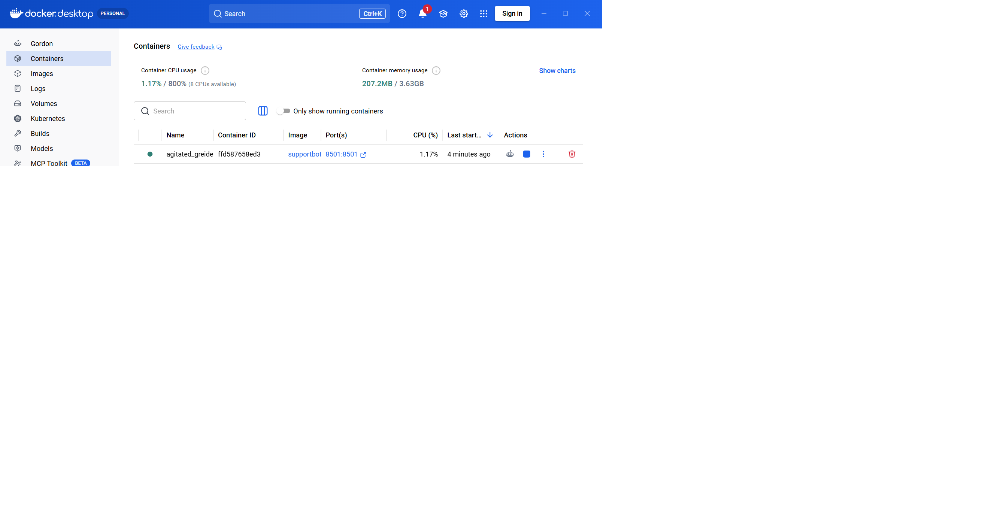

# SupportBot: An Intent-Aware Customer Support Chatbot with Dockerized Deployment and MLflow Tracking

SupportBot reads a customer message and works out what the customer wants (one of 27 **intents**, such as `cancel_order`, `get_refund` or `track_order`). It shows how confident it is and checks whether the message is a support request at all (**out-of-scope detection**). It then recommends whether a **human agent** should take over and suggests a reply.

> SICIP (Skills for Industry Competitiveness and Innovation Program), ML/DL final project.
> Dataset: [Bitext customer-support dataset](https://huggingface.co/datasets/bitext/Bitext-customer-support-llm-chatbot-training-dataset), with [CLINC150](https://huggingface.co/datasets/clinc/clinc_oos) out-of-scope queries used for evaluation only.


---

## What is implemented

The trainer's feedback was *"Try to improve/implement algorithms"*. So the core algorithms are written **from scratch** and compared against a library baseline:

| # | Model (one MLflow run each) | Implementation |
|---|---|---|
| 1 | **TF-IDF + Logistic Regression** | scikit-learn baseline (word 1-2-grams + character 2-5-grams) |
| 2 | **Multinomial Naive Bayes** | **from scratch**: own n-gram vectorizer, Lidstone smoothing, log-space scoring (`src/models/naive_bayes_scratch.py`) |
| 3 | **Transformer encoder (word)** | **from scratch** in PyTorch: own multi-head self-attention, encoder blocks, masked mean pooling, training loop with early stopping (`src/models/transformer_scratch.py`) |
| 4 | **Transformer encoder (sub-word)** | same as 3, plus fastText-style hashed character n-gram embeddings for robustness to typos |
| 5 | DistilBERT fine-tuning *(optional, off by default)* | Hugging Face transfer learning, for comparison |

On top of the classifier:

* **Out-of-scope detection**: compares three methods: maximum softmax probability, temperature-scaled softmax and the **energy score**. The threshold keeps 95% of in-scope validation messages (`src/ood.py`).
* **Confidence calibration**: **temperature scaling**, fitted on validation data and measured with Expected Calibration Error.
* **Robustness test**: a copy of the test set with ~15% of words corrupted by typos.
* **Escalation logic**: hand over to a human if the message is out of scope, confidence is low, the intent is sensitive (complaint, payment issue, asks for a human) or the customer sounds frustrated.
* **Reply suggestion**: retrieval. The reply of the most similar training message *within the predicted intent* (TF-IDF cosine similarity).

## Results

> Filled in from `results/evaluation.md` after training on the full dataset.

| Model | Val macro-F1 | Test accuracy | Test macro-F1 | Typo test macro-F1 | OOS AUROC | OOS FPR@95%TPR | Train time (s) |
|---|---|---|---|---|---|---|---|
| tfidf_logreg | | | | | | | |
| naive_bayes_scratch | | | | | | | |
| transformer_scratch_word | | | | | | | |
| transformer_scratch_subword | | | | | | | |


## Course techniques used and where

| Technique | Where |
|---|---|
| Data collection & splitting (stratified train/val/test) | `src/data_download.py` |
| Exploratory data analysis | `notebooks/exploration.ipynb` |
| Text preprocessing, tokenization, n-grams, TF-IDF | `src/common.py`, `src/models/naive_bayes_scratch.py`, `src/models/tfidf_logreg.py` |
| Probabilistic classifier (Naive Bayes) from scratch | `src/models/naive_bayes_scratch.py` |
| Linear model (Logistic Regression) | `src/models/tfidf_logreg.py` |
| Deep learning: embeddings, self-attention, Transformer, LayerNorm, residuals, dropout | `src/models/transformer_scratch.py` |
| Optimisation: AdamW, one-cycle learning-rate schedule, gradient clipping, label smoothing, weight decay, early stopping | `src/models/transformer_scratch.py` |
| Transfer learning (optional) | `src/models/distilbert_finetune.py` |
| Evaluation: accuracy, macro-F1, confusion matrix, per-class report, AUROC, FPR@95TPR, ECE | `src/train.py`, `src/evaluate.py`, `src/ood.py` |
| Calibration (temperature scaling) and out-of-distribution detection | `src/ood.py` |
| Robustness testing (noisy inputs) | `src/data.py` |
| Experiment tracking: params, metrics, plots, artifacts | MLflow, `src/train.py`, `mlruns/` |
| Model selection on validation data only | `src/train.py` |
| Inference pipeline + CLI | `src/predict.py`, `src/responder.py` |
| Web app (text + file upload) | `app/app.py` (Streamlit) |
| Containerisation | `Dockerfile` |

## Project structure

```
├── README.md
├── final_report.md
├── requirements.txt          # full environment (training + app)
├── requirements-app.txt      # minimal packages for the Docker app
├── Dockerfile
├── configs/config.yaml       # all hyper-parameters and runs
├── src/
│   ├── data_download.py      # download Bitext + CLINC150 OOS, make splits
│   ├── data.py               # load splits, typo noise for the robustness test
│   ├── models/               # tfidf_logreg, naive_bayes_scratch, transformer_scratch, distilbert_finetune
│   ├── ood.py                # out-of-scope detection + temperature scaling + calibration
│   ├── responder.py          # reply retrieval
│   ├── plots.py
│   ├── train.py              # trains all runs, logs to MLflow, exports best model
│   ├── evaluate.py           # evaluates the best model -> results/
│   ├── predict.py            # full pipeline + CLI
│   └── mlflow_ui.py          # opens the MLflow UI on ./mlruns
├── app/app.py                # Streamlit app
├── notebooks/exploration.ipynb
├── samples/sample_queries.csv
├── mlruns/                   # MLflow tracking data (committed)
├── results/                  # evaluation tables and plots (committed)
├── screenshots/
├── data/ models/ artifacts/  # created locally, not committed
```

## How to run

Python 3.10–3.12 is recommended.

```bash
# 1. environment
python -m venv .venv
.venv\Scripts\activate            # Windows   (macOS/Linux: source .venv/bin/activate)
pip install -r requirements.txt

# 2. data  (downloads into data/, which is not committed)
python src/data_download.py

# 3. train all models (one MLflow run each), export the best one to models/best/
python src/train.py --config configs/config.yaml

# 4. evaluate the best model  ->  results/evaluation.md
python src/evaluate.py

# 5. predict from the command line
python src/predict.py --input "I was charged twice for my order"
python src/predict.py --input samples/sample_queries.csv --output results/predictions.csv

# 6. MLflow UI  ->  http://localhost:5000
python src/mlflow_ui.py

# 7. web app without Docker  ->  http://localhost:8501
streamlit run app/app.py
```

> **MLflow note:** recent MLflow versions only accept the `./mlruns` folder store when `MLFLOW_ALLOW_FILE_STORE=true` is set. `src/train.py` and `src/mlflow_ui.py` set it for you. To start the UI by hand, run (PowerShell)
> `$env:MLFLOW_ALLOW_FILE_STORE="true"; mlflow ui --backend-store-uri ./mlruns --port 5000`

### Docker

Train first, so that `models/best/` exists. Then:

```bash
docker build -t supportbot-app:1.0 .
docker run -p 8501:8501 supportbot-app:1.0
```

Open http://localhost:8501. Type a message or upload a CSV/TXT file of messages, then download the results as CSV.

## MLflow tracking

Every run logs:

* **parameters**: hyper-parameters, seed and dataset sizes;
* **metrics**: per-epoch loss, accuracy and F1; accuracy and macro-F1 on validation, test and the typo test; AUROC and FPR@95TPR for each out-of-scope method; ECE before and after temperature scaling; training time, latency and model size;
* **artifacts**: confusion matrix, training curves, out-of-scope score histogram, classification report, misclassified examples, model info and config.

The best run is tagged `best_model = true`.




## Limitations

* Bitext messages are synthetic paraphrases, so in-distribution accuracy is very high. Real customer messages are messier, which is why the typo test and out-of-scope test are reported.
* Replies are retrieved templates with placeholders, not generated text. A production system would fill them from the order database.
* English only.

## Acknowledgements

* Dataset: Bitext (CDLA-Sharing-1.0). Out-of-scope queries: CLINC150 (Larson et al., 2019).
* Methods: Hendrycks & Gimpel (2017) MSP; Guo et al. (2017) temperature scaling; Liu et al. (2020) energy-based OOD detection; Vaswani et al. (2017) Transformer; Bojanowski et al. (2017) sub-word embeddings.
* An AI assistant (Claude) helped with code scaffolding and documentation. Experiments were run, checked and interpreted by the author.
