# SupportBot: An Intent-Aware Customer Support Chatbot with Dockerized Deployment and MLflow Tracking

**Khandakar Humyra Oyshi** · Trainee ID 1000128211 · SICIP Batch 2 · 25 November 2026

Repository: https://github.com/HuOyshi/SupportBot

## 1. Introduction

### 1.1 Brief Introduction

This project belongs to the domain **NLP-powered chatbot for customer support**. SupportBot is an intent-aware text classification system. It reads a customer's message, identifies which of **27 customer-support intents** it belongs to (for example `cancel_order`, `get_refund` or `track_order`), and decides whether the bot can answer it or should hand it over to a human agent.

The purpose is to automate the first response of a support desk safely. Routine requests should be answered quickly. Messages that are off-topic, unclear or sensitive should be recognised and passed to a person. For every message, the final system returns:

- the intent and its category, with a calibrated confidence and the top 3 alternatives;
- an out-of-scope flag for messages that are not support requests;
- an escalation recommendation with its reason;
- a suggested reply.

The system is served as a Streamlit web app in Docker. Users can type a single message or upload a CSV/TXT file of messages.

The proposal feedback was to *improve or implement algorithms*. In response, the two main classifiers were **implemented from scratch** and compared with a library baseline: a Multinomial Naive Bayes model and a Transformer encoder with its own multi-head self-attention. The project also adds out-of-scope detection, confidence calibration and a robustness test with typos.

### 1.2 Problem Statement

Online shops and service companies receive large numbers of short, informally written support messages. Sorting them by hand is slow. A badly designed bot is also harmful: it may confidently answer a question it has misunderstood, or force an unrelated question into the closest intent.

- **Input:** a short English customer message, typed in the app or uploaded as a CSV/TXT file of many messages.
- **Output:**
   - the predicted intent and its category, a calibrated confidence and the top 3 intents;
   - an out-of-scope flag;
   - an escalation decision with its reason;
   - a suggested reply.
- **Users:** customer-support teams that want to triage tickets automatically, and agents who receive the escalated cases with the predicted intent already attached.
- **Why it matters:** fast and correct routing shortens response times. For a support bot, knowing when *not* to answer is as important as accuracy, because wrong automatic answers damage customer trust.

### 1.3 Objectives

1. Train and compare four intent classifiers on the Bitext dataset, two of them implemented from scratch, using stratified splits and validation-based model selection.
2. Add out-of-scope detection, temperature-scaled confidence and an escalation policy, and test robustness to typing errors.
3. Track every experiment with MLflow (parameters, metrics, plots and artifacts) and keep `mlruns/` in the repository.
4. Build a prediction app with text input and CSV/TXT upload, and serve it with Docker.
5. Make the project reproducible from a fresh clone: automatic data download, config-driven training and fixed random seeds.

## 2. Dataset and Preparation

### 2.1 Dataset Description

|  | Bitext customer-support dataset | CLINC150 out-of-scope queries |
|---|---|---|
| Source | Hugging Face: bitext/Bitext-customer-support-llm-chatbot-training-dataset | Hugging Face: clinc/clinc_oos (config plus, label oos) |
| Role | Training, validation and test | Out-of-scope evaluation only (never used for training) |
| Samples | 26,872 messages | 100 validation and 1,000 test queries |
| Classes | 27 intents in 11 categories | One class: out of scope |
| Input type | Short English text (customer message) | Short English text |
| Target | intent (also category and an example reply) | None (used to test rejection) |

The 11 categories are ACCOUNT, CANCEL, CONTACT, DELIVERY, FEEDBACK, INVOICE, ORDER, PAYMENT, REFUND, SHIPPING and SUBSCRIPTION. The classes are roughly balanced, at about 1,000 messages per intent. The messages vary in style on purpose: colloquial wording, questions, polite forms and typing errors. Every message comes with an example reply. The replies contain placeholders such as `{{Order Number}}`.

Bitext has no off-topic messages, so the out-of-scope queries of CLINC150 (for example *"what's the weather tomorrow"*) were added. They measure whether the bot can recognise messages it should not answer.

### 2.2 Data Access

The data is fetched by `src/data_download.py` with one command. The script uses the `huggingface_hub` library to download:

- the Bitext CSV file. If the file has been renamed upstream, it falls back to the first CSV in the repository;
- the CLINC150 validation and test parquet files. If Hugging Face is unavailable, it falls back to the original CLINC JSON file on GitHub.

All files are saved in the local `data/` folder. The script also creates the train, validation and test splits. `data/` is listed in `.gitignore`; only an empty `data/.gitkeep` is committed, so no dataset is stored on GitHub.

### 2.3 Preprocessing

- **Cleaning:** the needed columns are kept and rows with a missing message or intent are dropped.
- **De-duplication:** 2,237 exact duplicate messages are removed, leaving 24,635. The same sentence therefore cannot appear in both the training and the test set.
- **Stratified split (seed 42):** train 19,708 (80%), validation 2,463 (10%) and test 2,464 (10%). Every intent has the same share in each split.
- **Text normalisation and tokenization:** lower-casing, unified quote characters, collapsed whitespace and a regular-expression tokenizer for words, numbers and punctuation.
- **Model features:**
   - TF-IDF on word 1–2-grams and character 2–5-grams for the baseline;
   - word uni-gram and bi-gram counts (minimum document frequency 2) for Naive Bayes;
   - a word vocabulary, plus hashed character 3–5-grams in the sub-word run, for the Transformer. Messages are cut at 32 tokens, which covers almost every message.
- **Noisy test set:** a copy of the test set in which about 15% of the words contain a typo (a deleted, swapped, doubled or replaced letter). It is used to test robustness.
- **Replies:** placeholders such as `{{Order Number}}` are shown as `[Order Number]`.

## 3. Methodology

### 3.1 Course Techniques Used

| Technique | Where used |
|---|---|
| MLflow experiment tracking | src/train.py, mlruns/, src/mlflow_ui.py |
| Dockerized prediction app | Dockerfile, requirements-app.txt |
| UI model serving (Streamlit, text + file upload) | app/app.py |
| Transformer architecture (self-attention, LayerNorm, residuals, dropout), from scratch | src/models/transformer_scratch.py |
| Probabilistic classifier (Naive Bayes), from scratch | src/models/naive_bayes_scratch.py |
| Classical ML baseline: TF-IDF + Logistic Regression | src/models/tfidf_logreg.py |
| Optimisation: AdamW, one-cycle learning rate, gradient clipping, label smoothing, early stopping | src/models/transformer_scratch.py |
| Data preprocessing, de-duplication, stratified split | src/data_download.py, src/common.py |
| Exploratory data analysis | notebooks/exploration.ipynb |
| Hyperparameter and threshold tuning on validation data | configs/config.yaml, src/threshold_check.py |
| Evaluation and error analysis (macro-F1, confusion matrix, AUROC, calibration) | src/evaluate.py, src/ood.py, src/train.py |
| Transfer learning (DistilBERT, optional run) | src/models/distilbert_finetune.py |
| Reproducible, config-driven project structure | configs/config.yaml, whole repository |

### 3.2 Model Architecture

Four classifiers were trained, one MLflow run each. All four share the same interface: they return one raw score (logit) per intent.

| Model | Description |
|---|---|
| TF-IDF + Logistic Regression (scikit-learn) | 60,000 TF-IDF features (30k word 1–2-grams + 30k character 2–5-grams), multinomial logistic regression with L2 regularisation, C = 10. |
| Multinomial Naive Bayes (from scratch) | Own n-gram vectorizer and counting. Score(c) = log P(c) + Σ count(w)·log P(w|c), with Lidstone smoothing α = 0.5. |
| Transformer encoder, word (from scratch, PyTorch) | Word embedding (d = 128) + learned position embedding → 2 pre-norm encoder blocks (4-head self-attention, feed-forward 256 with GELU, dropout 0.1, residual connections) → LayerNorm → masked mean pooling → linear layer with 27 outputs. |
| Transformer encoder, sub-word (from scratch) | Same as above. Each word vector also adds the sum of its hashed character 3–5-gram vectors (20,000 buckets, fastText-style), so misspelled words still share most of their n-grams with the correct word. |

**Loss and optimiser (Transformers):** cross-entropy with label smoothing 0.1; AdamW (learning rate 1e-3, weight decay 0.01) with a one-cycle learning-rate schedule; gradient clipping at 1.0; batch size 64. No pretrained weights are used: all four models are trained from zero on Bitext. A DistilBERT fine-tuning run is included in the code as an optional transfer-learning comparison, but it is switched off by default because it is slow on a laptop CPU.

**Components on top of the classifier:**

- **Temperature scaling:** logits are divided by a temperature T fitted on validation data, so the displayed confidence is calibrated.
- **Out-of-scope score:** three scores are compared: maximum softmax probability (MSP), temperature-scaled MSP and the energy score T·logsumexp(logits/T).
- **Reply retrieval:** the suggested reply is taken from the most similar training message (TF-IDF cosine similarity) within the predicted intent.

### 3.3 Training Strategy

- **Setup:** all models were trained on a laptop CPU (Windows 11, Python 3.12) with random seed 42. All settings come from `configs/config.yaml`.
- **Validation:** the validation split (2,463 messages) is used for:
   - early stopping of the Transformers: validation macro-F1, patience 3, at most 12 epochs, keeping the best epoch's weights;
   - fitting the temperature T;
   - choosing the out-of-scope method: the best AUROC on the 100 CLINC150 validation queries;
   - setting the out-of-scope threshold.
- **Model selection:** the model with the highest validation macro-F1 is exported to `models/best/`; ties are broken by validation out-of-scope AUROC. This was **TF-IDF + Logistic Regression** (validation macro-F1 0.9980). The sub-word Transformer was a close second at 0.9975.
- **Test data:** the test split, the noisy test split and the CLINC150 test queries are used only to report results, never to make a decision.

## 4. Experiments and Results

### 4.1 MLflow Tracking

All runs are stored in the MLflow experiment **supportbot-intent-classification** in the local `mlruns/` folder. The folder is committed to the repository.

- **Parameters logged:**
   - model type, every hyperparameter, random seed and dataset sizes;
   - the out-of-scope method chosen for the run.
- **Metrics logged:**
   - per-epoch training/validation loss, accuracy and macro-F1 for the Transformers;
   - accuracy and macro-F1 on the validation, test and noisy test sets;
   - AUROC and FPR@95%TPR for each out-of-scope method;
   - calibration error (ECE) before and after temperature scaling;
   - training time, latency per message, model size and number of parameters.
- **Artifacts saved:**
   - confusion matrix, training curves and out-of-scope score histogram;
   - classification report and misclassified test examples;
   - model_info.json and the configuration file.
- **Number of runs:** 6, all finished successfully. These are the 4 models, plus 2 extra TF-IDF runs from the out-of-scope threshold experiment (section 4.2).
- **Best run:** the final TF-IDF + Logistic Regression run. It has the highest validation macro-F1 and is tagged `best_model = true`.

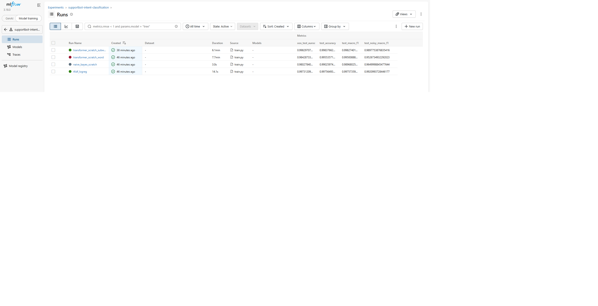
*Figure 1. MLflow experiment page with the training runs and their main metrics.*

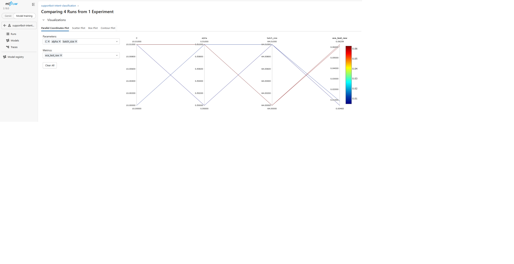
*Figure 2. MLflow run comparison: parallel-coordinates plot of hyperparameters and the calibration error of the runs.*

### 4.2 Evaluation Results

**Model comparison.** The test set has 2,464 messages. The out-of-scope test set has 1,000 queries. FPR@95%TPR is the share of out-of-scope queries wrongly accepted when 95% of real messages are accepted; lower is better.

| Model | Val F1 | Test acc. | Test F1 | Typo F1 | OOS AUROC | FPR@95 | Train time |
|---|---|---|---|---|---|---|---|
| TF-IDF + LogReg | 0.9980 | 0.9976 | 0.9976 | 0.9921 | 0.9973 | 0.0060 | 9 s |
| Naive Bayes (scratch) | 0.9859 | 0.9903 | 0.9897 | 0.9650 | 0.9803 | 0.0870 | 0.9 s |
| Transformer word (scratch) | 0.9921 | 0.9955 | 0.9950 | 0.9527 | 0.9843 | 0.0440 | 457 s |
| Transformer sub-word (scratch) | 0.9975 | 0.9984 | 0.9983 | 0.9898 | 0.9983 | 0.0030 | 362 s |

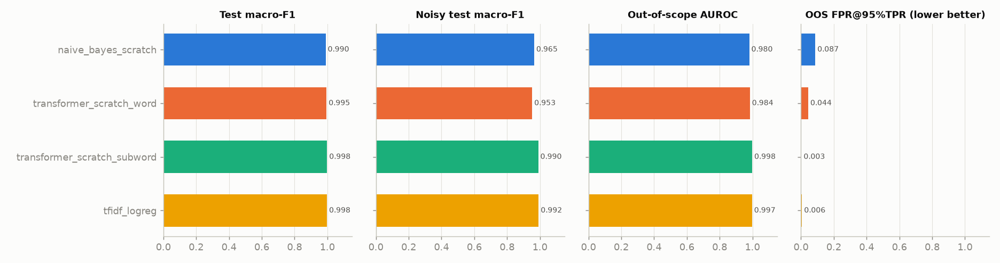
*Figure 3. Test macro-F1, noisy-test macro-F1, out-of-scope AUROC and FPR@95%TPR for the four models.*

**Final model (TF-IDF + Logistic Regression) after threshold tuning:**

| Metric | Value |
|---|---|
| Test accuracy / macro-F1 | 0.9976 / 0.9976 |
| Noisy (typo) test accuracy / macro-F1 | 0.9923 / 0.9921 |
| Calibration error (ECE) before → after temperature scaling (T = 0.52) | 0.0089 → 0.0014 |
| Out-of-scope AUROC (energy score) | 0.9973 |
| Out-of-scope queries rejected at the chosen threshold | 95.6% |
| In-scope messages accepted | 99.76% |
| End-to-end in-scope accuracy (accepted and correctly classified) | 99.51% |

**Interpretation.**

- **All four models exceed 99% test accuracy.** Bitext messages are paraphrases of each other, so classification within the dataset is easy. The more informative tests are the typo test and the out-of-scope test.
- **Sub-word embeddings fixed the weak spot of the from-scratch Transformer.** The typo-test macro-F1 rose from 0.953 to 0.990. Wrongly accepted out-of-scope queries (FPR@95%TPR) fell from 4.4% to 0.3%.
- **The energy score fails for Naive Bayes**: AUROC 0.105, worse than chance. Naive Bayes scores are log-probabilities of the *whole message*, so short off-topic questions look more likely than longer support messages. The method is chosen per model on validation data, so Naive Bayes uses temperature-scaled MSP instead (see the table below).
- **Calibration:** temperature scaling reduced the calibration error by about 84%, so the confidence shown in the app can be trusted.

| Model | MSP | Temperature-scaled MSP | Energy |
|---|---|---|---|
| TF-IDF + LogReg | 0.9976 | 0.9966 | 0.9973 |
| Naive Bayes (scratch) | 0.9777 | 0.9803 | 0.1051 |
| Transformer word (scratch) | 0.9831 | 0.9843 | 0.9758 |
| Transformer sub-word (scratch) | 0.9982 | 0.9979 | 0.9983 |

*Out-of-scope AUROC on the test queries for each scoring method.*

**Choosing the out-of-scope threshold.** At first, the threshold accepted 95% of in-scope validation messages. The app then rejected everyday phrasings that are not in Bitext, such as *"can i pay with paypal?"*, even when the intent was predicted correctly with over 99% confidence. `src/threshold_check.py` compared threshold rules on validation data and on 20 hand-written messages (`samples/sample_queries.csv`). Results for TF-IDF with the energy score:

| Threshold rule | Val. in-scope accepted | Val. OOS rejected | Real-style accepted (16) | Off-topic rejected (4) |
|---|---|---|---|---|
| keep 95% | 95.0% | 100% | 7 | 4 |
| keep 99% | 99.0% | 99% | 8 | 4 |
| keep 99.5% (chosen) | 99.5% | 98% | 11 | 4 |
| keep 99.9% | 99.9% | 89% | 12 | 3 |

The 99.5% rule was chosen. Of the 5 sample messages that are still escalated, 4 were misclassified by every model: heavy typos such as *"hw do i trak my ordr"*, *"charged twice!!!"* and *"where is my package?"*. Sending them to a human is the intended behaviour. The choice was guided by these hand-written samples, so it is a judgement call rather than an unbiased test result.

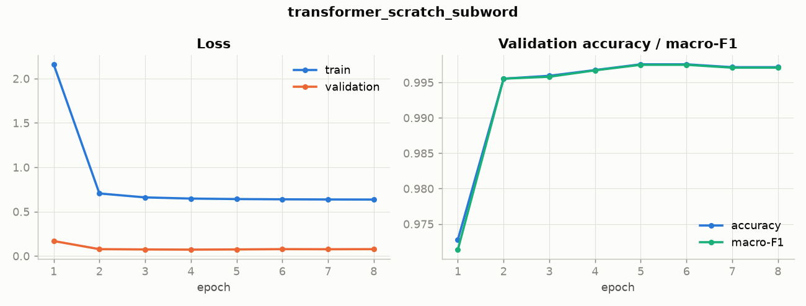
*Figure 4. Training curves of the sub-word Transformer. Early stopping ended training after epoch 8; the weights of the best epoch (5) were kept.*

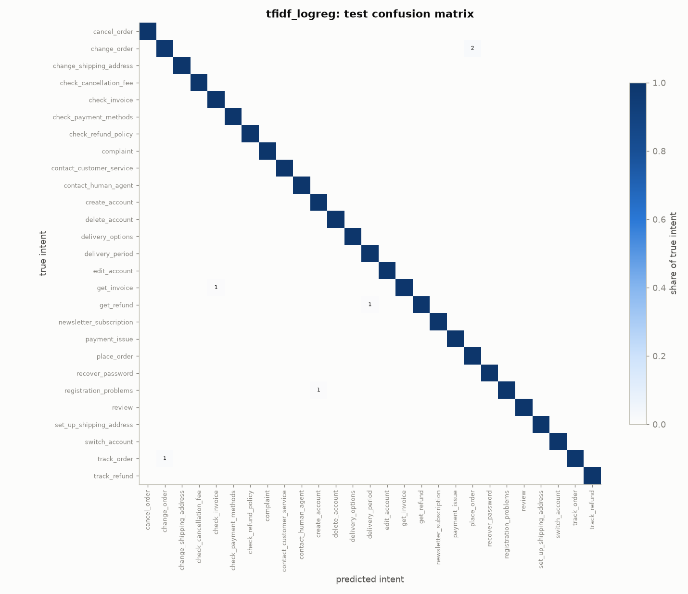
*Figure 5. Test confusion matrix of the final model (row-normalised; numbers show the errors).*

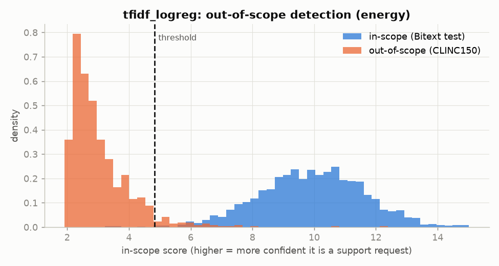
*Figure 6. Energy scores of in-scope test messages and CLINC150 out-of-scope queries, with the chosen threshold.*

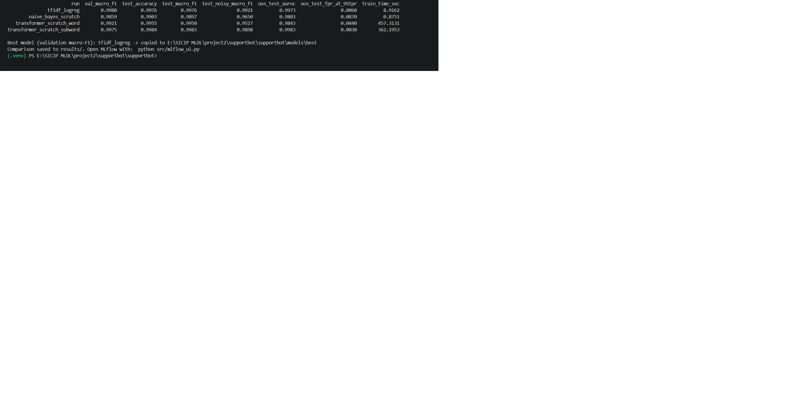
*Figure 7. Terminal output at the end of training (comparison table and best model).*

## 5. Prediction App and Docker

### 5.1 Prediction Pipeline

The pipeline is implemented in `src/predict.py` (class `SupportBot`). The same code is used by the command-line tool and the web app.

1. **Input:** the user types a message, or uploads a CSV file (column `text`, otherwise the first column) or a TXT file (one message per line).
2. **Preprocessing:** the text is normalised and turned into TF-IDF features, the same way as during training.
3. **Prediction:** the model computes one logit per intent. These are converted to calibrated probabilities with the temperature T. The top intent and the top 3 are kept.
4. **Out-of-scope check:** the energy score is compared with the threshold stored in `model_info.json`.
5. **Escalation:** the message is escalated if any of these applies:
   - it is out of scope;
   - the confidence is below 0.5;
   - the intent is sensitive (`complaint`, `payment_issue`, `contact_human_agent`);
   - it contains frustration words such as *unacceptable* or *!!!*.
6. **Reply:** the reply of the most similar training message of the predicted intent is returned, with placeholders shown in [brackets]. Out-of-scope messages get a polite fallback reply.
7. **Output:** intent, category, confidence, top 3 intents, out-of-scope flag, escalation decision with its reason, and the reply.

### 5.2 Prediction UI

The user interface is built with **Streamlit** (`app/app.py`). It has two tabs:

- **Single message:** a text box with example buttons. It shows the detected intent, category and confidence; a green, yellow or red box for no escalation, out of scope or escalation; the suggested reply; and bars for the top 3 intents.
- **Upload a file:** CSV or TXT upload. It shows the number of messages, the escalation and out-of-scope rates, an intent-distribution chart and the full results table, which can be downloaded as a CSV file.

A sidebar shows the model in use, its test metrics, the out-of-scope method and threshold, and the escalation rules.

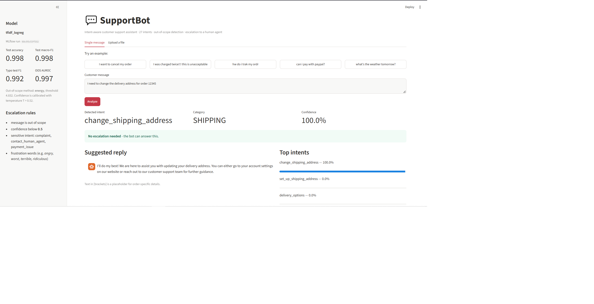
*Figure 8. Single-message prediction: intent, confidence, decision, suggested reply and top 3 intents.*

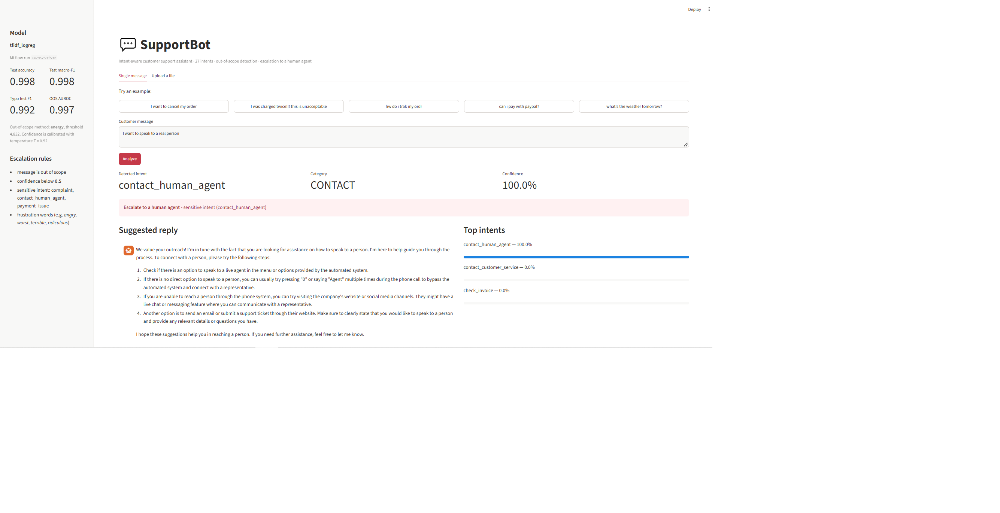
*Figure 9. A request for a human agent is escalated, and the reason is shown.*

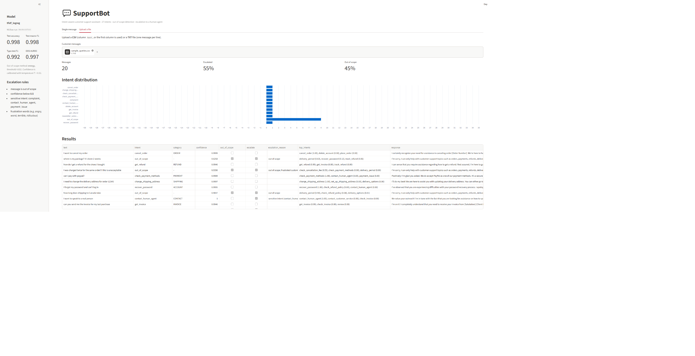
*Figure 10. File upload: the 20 sample messages analysed at once, with summary, chart and downloadable results.*

### 5.3 Docker Serving

The prediction app is served with Docker. The repository contains a `Dockerfile` that:

- builds on the `python:3.11-slim` image;
- installs CPU-only PyTorch and the few packages the app needs (`requirements-app.txt`). It does not install MLflow or the training tools, which keeps the image small;
- copies the source code, configuration and trained model (`models/best/`);
- starts Streamlit on port 8501, with a health check.

The README gives the docker build and docker run commands and explains how to upload sample data. The model must be trained first so that `models/best/` exists. Figure 11 shows the Docker-served app running.

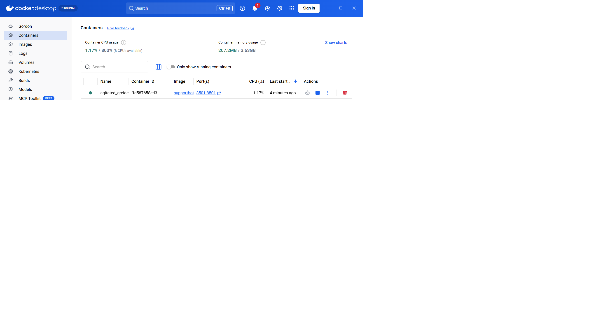
*Figure 11. The SupportBot container (image supportbot-app:1.0) running in Docker Desktop, serving the app on port 8501.*

## 6. Repository and Reproducibility

### 6.1 Repository Structure

The repository is public at https://github.com/HuOyshi/SupportBot. Its main items are:

- `README.md`: overview, dataset, setup, commands, results, screenshots and limitations;
- `final_report.md` and this report as a PDF;
- `requirements.txt` (full environment) and `requirements-app.txt` (Docker app);
- `.gitignore`, `.dockerignore` and `Dockerfile`;
- `src/`: the scripts `data_download.py`, `data.py`, `train.py`, `evaluate.py`, `predict.py`, `responder.py`, `ood.py`, `threshold_check.py`, `plots.py` and `mlflow_ui.py`, plus `models/` with the four model implementations;
- `app/app.py`: the Streamlit app;
- `configs/config.yaml`: all hyperparameters and runs;
- `notebooks/exploration.ipynb`: exploratory data analysis;
- `mlruns/` (MLflow runs), `results/` (evaluation tables and plots), `screenshots/` and `samples/`;
- `models/`, `data/` and `artifacts/`: only `.gitkeep` files are committed. Their contents are created locally.

### 6.2 GitHub Rules

The `.gitignore` file keeps out of the repository:

- downloaded data (`data/`);
- trained model files (`models/`, `artifacts/`);
- the virtual environment (`.venv/`);
- Python caches and notebook checkpoints;
- `.env` files.

No credentials are needed, because both datasets are public. The `mlruns/` folder is **not** ignored, so reviewers can inspect all parameters, metrics and artifacts. Only small plots and reports are logged to MLflow, which keeps the repository small. The trained models are not committed because they can be recreated with the training script.

The project was committed in steps rather than in a single upload: project structure, data pipeline, models, training and evaluation, app and Docker, results, screenshots and the report.

### 6.3 Reproducibility

A reviewer can reproduce the work from a fresh clone in this order. The exact commands are in the README.

1. Create a virtual environment and install the dependencies from `requirements.txt`.
2. Run the data script, which downloads Bitext and CLINC150 into `data/` and creates the splits.
3. Run the training script, which trains all models and logs them to MLflow. It takes about 15 minutes on a laptop CPU.
4. Open the MLflow UI with the helper script. The helper also fixes the absolute artifact paths that MLflow stores, so the plots open on any computer.
5. Run the evaluation script, which writes the tables and plots in `results/`.
6. Build and run the Docker image, then open the app in the browser.

Results are repeatable because:

- all settings are in one configuration file;
- random seeds are fixed;
- the data split is stratified with a fixed seed.

## 7. Limitations and Future Work

### 7.1 Limitations

- **Synthetic training data:** Bitext messages are generated paraphrases, so test accuracy above 99% overstates real-world accuracy. Real-style messages scored lower on the out-of-scope check.
- **Heavy typos in very short messages**, such as *"hw do i trak my ordr"*, are misclassified by all four models.
- **Threshold trade-off:** accepting more real messages also lets more off-topic ones through. 95.6% are rejected at the chosen threshold, compared with 99.4% at the strictest setting. The threshold was tuned with only 20 hand-written samples.
- **Template replies:** replies are retrieved templates with placeholders, not answers based on the customer's real order data.
- **Single messages, English only:** the bot handles one message at a time, with no conversation memory.

### 7.2 Future Improvements

- Collect and label real customer messages for fine-tuning and for a realistic test set.
- Run the included DistilBERT fine-tuning, or a larger pretrained Transformer, on a GPU and compare it with the from-scratch models.
- Add spelling correction, or train with more typo augmentation.
- Fill reply placeholders from an order database, or use a grounded generative model for replies.
- Support multi-turn conversations and a Bangla/Banglish version.
- Learn from the escalated messages that agents label (active learning).

## 8. Conclusion

SupportBot addresses the routing of customer-support messages. It predicts one of 27 intents, recognises messages it should not answer, and recommends when a human should take over. A Multinomial Naive Bayes model and a Transformer encoder were implemented from scratch and compared with a TF-IDF + Logistic Regression baseline.

All four models reach over 99% test accuracy. The main finding is that sub-word embeddings make the from-scratch Transformer robust: typo-test F1 rose from 0.953 to 0.990, and the out-of-scope false-acceptance rate fell from 4.4% to 0.3%. The deployed TF-IDF model reaches 99.76% test accuracy and 99.51% end-to-end accuracy, with well-calibrated confidence.

The Docker-served Streamlit app shows the whole pipeline on typed or uploaded messages. All experiments are tracked in MLflow.

The main lesson was that high accuracy on a clean dataset is not enough. A threshold tuned on synthetic data was too strict for real phrasing. Testing with typos, off-topic questions and hand-written messages showed the real behaviour of the system.

## Appendix

### A. Final Submission Checklist

✔ Selected one approved project domain: NLP-powered chatbot for customer support.
✔ Public GitHub repository is accessible: https://github.com/HuOyshi/SupportBot
✔ Dataset is not committed to GitHub.
✔ Data can be downloaded into data/ (src/data_download.py).
✔ Training uses MLflow.
✔ mlruns/ is included and not ignored.
✔ At least two MLflow runs are logged (6 runs).
✔ Report includes MLflow screenshots (Figures 1 and 2).
✔ Prediction app supports sample upload and text input.
✔ Prediction app is served using Docker.
✔ Report includes a Docker app screenshot (Figure 11).
✔ Course techniques used are clearly mentioned (section 3.1 and the README).
✔ Deadline is respected: 28 November 2026, 11:59 pm.

### B. Final Notes

Repository: https://github.com/HuOyshi/SupportBot

**Use of AI assistance:** an AI assistant (Claude, Anthropic) helped with code scaffolding, debugging and drafting the documentation and this report. The author chose the project, ran all data downloads, training runs, evaluations and the Docker app on her own laptop, checked the results, and made the analysis decisions, such as the out-of-scope threshold.

**References:**

- Bitext. Customer Support LLM Chatbot Training Dataset. Hugging Face, CDLA-Sharing-1.0.
- S. Larson et al., "An Evaluation Dataset for Intent Classification and Out-of-Scope Prediction," EMNLP-IJCNLP, 2019.
- A. Vaswani et al., "Attention Is All You Need," NeurIPS, 2017.
- P. Bojanowski et al., "Enriching Word Vectors with Subword Information," TACL, 2017.
- D. Hendrycks and K. Gimpel, "A Baseline for Detecting Misclassified and Out-of-Distribution Examples in Neural Networks," ICLR, 2017.
- C. Guo et al., "On Calibration of Modern Neural Networks," ICML, 2017.
- W. Liu et al., "Energy-based Out-of-distribution Detection," NeurIPS, 2020.
